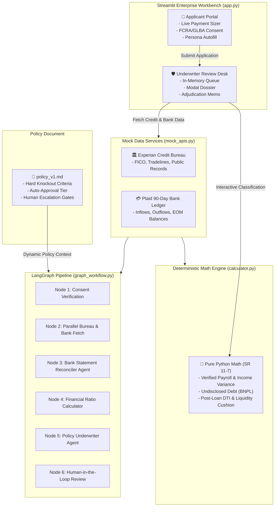

# 🏦 Apex Financial — Institutional Loan Underwriting & Approval Workbench

An enterprise-grade, FCRA & GLBA-compliant personal installment loan underwriting workbench and agentic decisioning platform. Built with **Streamlit**, **LangGraph**, and **Pydantic**, featuring deterministic financial ratio analysis, interactive bank cash flow classification, and human-in-the-loop credit adjudication.

---

## 🌟 Executive Summary

Apex Financial delivers a modern, high-trust credit decisioning platform designed for unsecured personal installment loans ($1,000 – $50,000, fixed 36-month term at 12.0% APR).

The system seamlessly combines:
1. **Interactive Dual-Role Web Workbench**:
   - **Loan Applicant Portal**: Real-time installment payment calculator, clean input state with contextual placeholders, regulatory consent capture, and 1-click demo persona autofill.
   - **Credit Underwriting Desk**: Modal-driven adjudication console, interactive bank cash flow categorizer with debit/credit-specific options, instant AI auto-classify shortcut, gated financial ratio worksheet, and a 1-click credit determination action panel with centered error validation.
2. **Deterministic Financial Calculation Engine (`calculator.py`)**:
   - SR 11-7 compliant pure Python functions for post-loan Debt-to-Income (DTI), verified payroll income, undisclosed BNPL debt detection, 90-day NSF event tallying, and liquidity cushion ratios.
3. **Multi-Agent LangGraph Pipeline (`graph_workflow.py`)**:
   - Autonomous multi-agent pipeline using LangGraph and Pydantic structured output for semantic bank reconciliation and dynamic policy evaluation without hardcoded credit policies.
4. **Single Source of Truth Credit Policy (`policy_v1.md`)**:
   - All underwriting tiers, knockout floors, and escalation gates are maintained in Markdown, guaranteeing zero policy hardcoding in business logic.

---

## 🏗️ System Architecture



---

## 📁 Repository Structure

```
loan-approval/
├── app.py                  # Streamlit Enterprise Underwriting Workbench
├── calculator.py           # Pure Python SR 11-7 Financial Ratio Calculator
├── graph_workflow.py       # 6-Node LangGraph Agentic Underwriting Workflow
├── mock_apis.py            # Experian & Plaid REST API Mock Providers & Personas
├── schema.py               # Pydantic Structured Output Schemas (Agents 1 & 2)
├── state.py                # LangGraph LoanApplicationState TypedDict
├── policy_v1.md            # Apex Financial Credit Underwriting Policy (US-2026)
├── requirements.txt        # Python Dependencies
├── .env                    # Environment Configuration (API Keys, Endpoints)
└── .streamlit/
    └── config.toml         # Streamlit Enterprise Light Theme Configuration
```

---

## 🚀 Key Modules & Capabilities

### 1. Enterprise Workbench (`app.py`)
- **Light Enterprise Design System**: Styled with a crisp slate and blue palette (Stripe/Mercury style), featuring JetBrains Mono typography for financial metrics.
- **In-Memory Global State (`@st.cache_resource`)**: Data persists across browser refreshes ($F5$ / $\text{Cmd}+R$) while clearing completely on application server restarts—zero persistent disk artifacts or database debris.
- **Credit Tradelines Tab**: Clean audit view with `Tradeline ID` removed, showing creditor name, account type, monthly obligation, 12-month delinquency history, and standing.
- **Bank Cash Flow Tab**: 
  - `Txn Id` removed from the audit display table.
  - Transactions start unclassified by default.
  - Strictly filtered dropdowns: **Credit entries** only display deposit/income options (*Verified Payroll Income*, *One-Off Gift / Transfer*, *Internal Account Transfer*), while **Debit entries** only display expense options (*Known Bureau Debt*, *Undisclosed Debt / BNPL*, *NSF / Overdraft Fee*, *Bank Maintenance Fee*, *Other Living Expense*).
  - **`✨ Auto-Classify (Demo AI)`** shortcut button to instantly categorize all entries using heuristic rules.
- **Financial Ratios Tab**:
  - The **`🧮 Calculate Financial Ratios`** button is disabled until **100% of cash flow transactions** are classified.
  - Generates comprehensive underwriting ratios (*Post-Loan DTI*, *Verified Monthly Income*, *Payment Cushion Ratio*) and an audit table cross-referencing policy guidelines.
  - Dynamically resets when any transaction classification is modified, enabling seamless re-calculation.
- **Adjudication Modal & Action Panel**:
  - Encapsulated inside `st.form` to ensure **1-click approval or rejection** immediately upon typing the justification memorandum, preventing unwanted blur reruns.
  - Centered validation error messages spanning the full decision column.

---

### 2. Financial Ratio Calculator (`calculator.py`)
All financial calculations are isolated in individual, pure functions:

| Function | Purpose | Formula / Logic |
| :--- | :--- | :--- |
| `get_fico_score()` | Extract FICO credit score | Extracted from credit report |
| `has_active_bankruptcy()` | Check active bankruptcy filings | `status == 'ACTIVE'` (Discharged filings ignored) |
| `get_total_delinquencies_12m()` | 12-Month delinquency tally | Sum of 30d + 60d + 90d+ late counts across tradelines |
| `count_nsf_overdraft_events()` | Punitive fee event count | Total 90-day NSF/overdraft ledger events |
| `calculate_verified_monthly_income()` | Bank-verified net payroll | $\frac{\sum \text{Verified Payroll Inflows}}{\text{Statement Months}}$ |
| `calculate_stated_monthly_income()` | Stated monthly gross income | $\frac{\text{Stated Gross Annual Income}}{12}$ |
| `calculate_income_variance_pct()` | Gross vs. net income variance | $\frac{|\text{Stated Monthly} - \text{Verified Monthly}|}{\text{Stated Monthly}} \times 100$ |
| `calculate_monthly_installment()` | Fixed-rate loan installment sizing | $P \times \frac{r(1+r)^n}{(1+r)^n - 1}$ ($r = 0.01$, $n = 36$) |
| `calculate_bureau_monthly_debt()` | Declared tradeline debt load | $\sum \text{Tradeline Monthly Payments}$ |
| `calculate_undisclosed_monthly_debt()` | Hidden debt obligations (BNPL) | $\frac{\sum \text{BNPL / Payday Outflows}}{\text{Statement Months}}$ |
| `calculate_total_post_loan_debt()` | Aggregate post-loan monthly debt | $\text{Bureau Debt} + \text{Hidden Debt} + \text{New Payment}$ |
| `calculate_post_loan_dti()` | Reconciled Post-Loan DTI % | $\frac{\text{Total Post-Loan Debt}}{\text{Verified Monthly Income}} \times 100$ |
| `calculate_avg_ending_balance()` | 90-Day average checking reserve | $\frac{\sum \text{EOM Ending Balances}}{\text{Months}}$ |
| `calculate_payment_cushion_ratio()` | Reserve liquidity multiple | $\frac{\text{Average Ending Balance}}{\text{New Monthly Loan Payment}}$ |
| `compute_financial_ratios()` | Master underwriting ratio engine | Bundles all metrics into a standardized dictionary |

---

### 3. Agentic LangGraph Underwriting Pipeline (`graph_workflow.py`)
A 6-node state machine orchestrating AI-driven credit analysis:
- **Node 1 (`verify_fcra_consent_node`)**: Regulatory gate ensuring explicit borrower consent before accessing bureau or banking data.
- **Node 2 (`fetch_external_data_parallel_node`)**: Parallel retrieval of Experian credit records and Plaid bank ledgers.
- **Node 3 (`bank_statement_analyzer_agent`)**: LLM-powered agent identifying verified income, undisclosed BNPL debt, and fee reversals.
- **Node 4 (`calculate_financial_ratios_node`)**: Pure Python mathematical calculation node.
- **Node 5 (`underwriter_agent_node`)**: Policy evaluation agent dynamically assessing `policy_v1.md` rules and generating ECOA-compliant adverse action notices when denying.
- **Node 6 (`human_review_node`)**: Human-in-the-loop review station for manual credit committee approval or sign-off.

---

## 👥 Demo Borrower Personas

The system includes 3 pre-configured demo borrower profiles accessible via the **`⚡ Autofill Demo Persona`** shortcut in the Applicant Portal:

```
┌─────────────────────────────────────────────────────────────────────────────┐
│ 1. Sarah Jenkins — Clean Auto-Approve (Prime)                                │
│    • Requested: $15,000 | Stated Income: $96,000/yr ($8,000/mo)             │
│    • FICO: 745 | Delinquencies: 0 | NSF Fees: 0                             │
│    • Public Records: Discharged Bankruptcy from 2019 (Compliant)            │
│    • Result: Passes all criteria, healthy DTI (< 36%), 4.2x cushion.        │
├─────────────────────────────────────────────────────────────────────────────┤
│ 2. Marcus Vance — Hard Knockout Denial (Subprime)                            │
│    • Requested: $20,000 | Stated Income: $60,000/yr ($5,000/mo)             │
│    • FICO: 580 (Violates Rule 2.1 < 620)                                    │
│    • Active Bankruptcy (Violates Rule 2.3) | 2x Delinquencies (Rule 2.3)    │
│    • 3x NSF Events in 90 Days (Violates Rule 2.4 > 2)                       │
│    • Result: Immediate ECOA Adverse Action Denial with specific citations.   │
├─────────────────────────────────────────────────────────────────────────────┤
│ 3. David Chen — Manual Underwriting Escalation (Nuanced / High-Value)        │
│    • Requested: $35,000 (Exceeds $25,000 Tier 1 Gate per Rule 4.2)          │
│    • Stated Income: $110,000/yr | FICO: 710                                 │
│    • Undisclosed BNPL detected (Klarna / Affirm payments)                   │
│    • Result: Routes to ESCALATE for human underwriter executive sign-off.   │
└─────────────────────────────────────────────────────────────────────────────┘
```

---

## ⚙️ Installation & Setup

### Prerequisites
- Python 3.10, 3.11, 3.12, or 3.13
- Virtual environment (`venv` or `conda`)

### 1. Clone & Set Up Virtual Environment
```bash
cd /Users/vipar/Data/projects/loan-approval
python3 -m venv venv
source venv/bin/activate
```

### 2. Install Dependencies
```bash
pip install -r requirements.txt
```

### 3. Configure Environment Variables
Create or edit `.env` in the root directory:
```bash
# Optional for LangGraph Agentic Execution (defaults to mock/local if unset)
OPENAI_API_KEY=your_api_key_here
# Optional custom endpoint (e.g. Groq, Ollama, vLLM)
OPENAI_BASE_URL=https://api.groq.com/openai/v1
```

---

## 🖥️ Running the Application

Launch the Streamlit Enterprise Workbench:
```bash
streamlit run app.py
```
Open your browser at `http://localhost:8501`.

### Recommended Walkthrough Flow:
1. Navigate to the **Applicant Portal**.
2. Click **`⚡ Autofill Demo Persona`** and select **Sarah Jenkins** (or Marcus Vance / David Chen).
3. Observe how the **Calculated Installment** updates instantly with any change to the requested loan amount.
4. Check the FCRA authorization box and click **Submit Loan Application**.
5. Switch to the **Underwriter Desk** via the sidebar navigation.
6. Click **Review & Adjudicate ↗** on the submitted application to open the modal dossier.
7. Under the **Bank Cash Flow** tab, either classify entries manually or click **`✨ Auto-Classify (Demo AI)`**.
8. Navigate to the **Financial Ratios** tab and click **`🧮 Calculate Financial Ratios`** to generate the ratio scorecard.
9. Type your credit rationale into **Credit Officer Justification** and click **✅ Approve** or **❌ Reject**.
10. Inspect the completed record in the **Adjudicated / Completed Archive** audit trail.

---

## 🧪 Testing & Validation

The project includes unit and integration tests verifying all calculation algorithms and interactive UI behaviors:

```bash
# Run deterministic calculation and schema validation tests
./venv/bin/python -c "
import calculator, mock_apis
print('FICO:', calculator.get_fico_score(mock_apis.fetch_experian_credit_report('4401')))
print('Installment ($15k):', calculator.calculate_monthly_installment(15000))
"
```

---

## ⚖️ Compliance & Governance Standards

- **SR 11-7 (Supervisory Guidance on Model Risk Management)**: Deterministic, explainable mathematical calculations separate from generative LLM reasoning.
- **FCRA (Fair Credit Reporting Act)**: Explicit permission check enforces authorization prior to credit bureau or bank ledger pull.
- **GLBA (Gramm-Leach-Bliley Act)**: Safeguarding consumer financial information with ephemeral, in-memory processing.
- **ECOA (Equal Credit Opportunity Act / Reg B)**: Mandatory adverse action reasoning citations on all rejected loan files.
