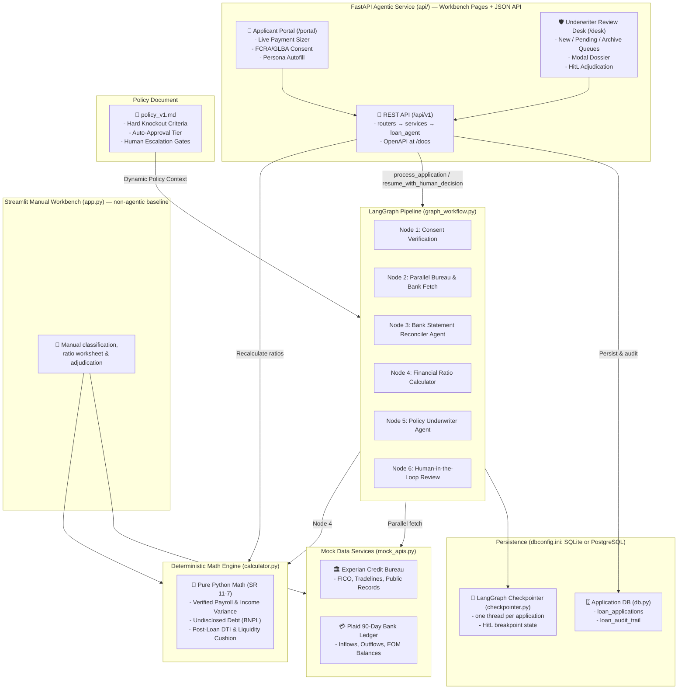

# 🏦 Apex Financial — Institutional Loan Underwriting & Approval Workbench

An enterprise-grade, FCRA & GLBA-compliant personal installment loan underwriting workbench and agentic decisioning platform. The **autonomous agentic service** is built with **FastAPI**, **LangGraph**, and **Pydantic** (JSON API + server-rendered workbench); the baseline **manual workbench** remains on **Streamlit**. Both feature deterministic financial ratio analysis, interactive bank cash flow classification, and human-in-the-loop credit adjudication.

> 💡 **Audience Presentation Quick-Reference**: Explaining banking concepts or ratios to your audience? Jump straight to the [📖 Glossary of Terms & Financial Underwriting Primer](#-glossary-of-terms--financial-underwriting-primer).

---

## 🌟 Executive Summary

Apex Financial delivers a modern, high-trust credit decisioning platform designed for unsecured personal installment loans ($1,000 – $50,000, fixed 36-month term at 12.0% APR).

The system seamlessly combines:
1. **Interactive Dual-Role Web Workbench** (FastAPI service `api/` for the agentic flow; Streamlit `app.py` for the manual baseline):
   - **Loan Applicant Portal**: Real-time installment payment calculator, clean input state with contextual placeholders, regulatory consent capture, and 1-click demo persona autofill.
   - **Credit Underwriting Desk**: Modal-driven adjudication console, interactive bank cash flow categorizer with debit/credit-specific options, instant AI auto-classify shortcut, gated financial ratio worksheet, and a 1-click credit determination action panel with centered error validation.
   - **Versioned JSON API (`/api/v1`)**: Every workbench action is an HTTP endpoint (OpenAPI docs at `/docs`), so new features, integrations, and alternative front-ends plug in without touching the UI.
2. **Deterministic Financial Calculation Engine (`calculator.py`)**:
   - SR 11-7 compliant pure Python functions for post-loan Debt-to-Income (DTI), verified payroll income, undisclosed BNPL debt detection, 90-day NSF event tallying, and liquidity cushion ratios.
3. **Multi-Agent LangGraph Pipeline (`graph_workflow.py`)**:
   - Autonomous multi-agent pipeline using LangGraph and Pydantic structured output for semantic bank reconciliation and dynamic policy evaluation without hardcoded credit policies.
4. **Single Source of Truth Credit Policy (`policy_v1.md`)**:
   - All underwriting tiers, knockout floors, and escalation gates are maintained in Markdown, guaranteeing zero policy hardcoding in business logic.

---

## 🏗️ System Architecture



---

## 📁 Repository Structure

```
loan-agent/
├── pyproject.toml              # Modern PEP 517/621 packaging & pytest configuration
├── requirements.txt            # Production application dependencies
├── requirements-dev.txt        # Development and testing dependencies (pytest, pytest-cov)
├── policy_v1.md                # Apex Financial Credit Underwriting Policy (US-2026)
├── dbconfig.ini                # Storage mode (local SQLite / remote PostgreSQL) & database locations
├── setup_env.sh                # Dev sandbox bootstrap: venv + activation + both requirements files
├── run_api.py                  # Launches the FastAPI agentic service (uvicorn)
├── initiate_workflow.py        # CLI/cron scheduler: runs the approval workflow via POST /api/v1/workflows/run
├── list_loans.py               # Admin CLI: queries applications / status summary via GET /api/v1/applications & /stats
├── trace_loan.py               # Admin CLI: consolidated audit trace via GET /api/v1/applications/{id} [+ /audit-trail]
├── app.py                      # Manual (non-agentic) credit underwriting workbench — Streamlit
├── agentic_app.py              # Agentic underwriting workbench — Streamlit (legacy; co-exists with api/ during migration)
├── .streamlit/
│   └── config.toml             # Streamlit theme for app.py / agentic_app.py
├── api/                        # ⭐ Autonomous agentic underwriting service — FastAPI
│   ├── main.py                 # App factory, lifespan (DB + checkpointer warm-up), router mounting
│   ├── dependencies.py         # DI providers (application DB, LangGraph checkpointer, workflow lock)
│   ├── schemas.py              # Pydantic request/response contracts (the public API surface)
│   ├── routers/                # HTTP layer only — validation, status codes, serialization
│   │   ├── applications.py     # /api/v1/applications: submit, list, detail, dossier, ratios, workflow, decision
│   │   ├── workflows.py        # /api/v1/workflows/run (fire-and-forget), /workflows/runs/{id}, /api/v1/stats
│   │   ├── admin.py            # /api/v1/admin: status summary, job health, run history, schedule config
│   │   ├── reference.py        # /api/v1/health, /system, /personas, /calculator, /policy
│   │   └── pages.py            # / , /portal, /desk (Jinja2 server-rendered workbench)
│   ├── services/               # Orchestration layer — no HTTP, no UI
│   │   ├── applications.py     # Submission, reference IDs, listing/stage filters, queue stats, projections
│   │   ├── dossier.py          # Review dossier assembly + deterministic ratio recalculation
│   │   ├── workflows.py        # Pipeline dispatch guards, batch runs, HitL decision resumption
│   │   ├── scheduler.py        # initiate_workflow run log, health evaluation, persisted interval, periodic trigger
│   │   └── policy.py           # policy_v1.md loader + Markdown → HTML
│   ├── templates/              # base.html, portal.html, desk.html, admin.html
│   └── static/                 # apex.css (enterprise light theme), api.js, portal.js, desk.js, admin.js
├── loan_agent/                 # Core reusable domain package (UI-agnostic)
│   ├── __init__.py             # Package exports & public API
│   ├── calculator.py           # Pure Python SR 11-7 Financial Ratio Calculator
│   ├── classification.py       # Transaction classification vocabulary, schema↔label maps, heuristic classifier
│   ├── graph_workflow.py       # 6-Node LangGraph Agentic Underwriting Workflow
│   ├── workflow_runner.py      # process_application / run_initiate_workflow / resume_with_human_decision
│   ├── api_cli.py              # REST-backed admin CLI (used by list_loans / trace_loan / initiate_workflow)
│   ├── db.py                   # Application DB: applications, audit trail, workflow run log, settings (SQLite / PostgreSQL)
│   ├── checkpointer.py         # LangGraph checkpointer factory (distinct database)
│   ├── config.py               # dbconfig.ini + environment variable resolution
│   ├── admin.py                # Direct-database list/trace actions (used internally and by tests)
│   ├── mock_apis.py            # Experian & Plaid REST API Mock Providers & Personas
│   ├── schema.py               # Pydantic Structured Output Schemas (Agents 1 & 2)
│   └── state.py                # LangGraph LoanApplicationState TypedDict
└── tests/                      # Automated unit, API & integration test suite
    ├── __init__.py
    ├── conftest.py             # Shared pytest fixtures, in-memory DBs & deterministic mock LLM
    ├── test_api.py             # End-to-end FastAPI tests (submit → pipeline → HitL decision → archive)
    ├── test_calculator.py      # Unit tests for financial ratio algorithms
    ├── test_mock_apis.py       # Unit tests for bureau/bank APIs & pre-filtering
    ├── test_schema.py          # Unit tests for Pydantic schemas & state models
    ├── test_workflow.py        # Unit tests for LangGraph nodes, routing, fallback
    ├── test_workflow_runner.py # Unit tests for the workflow engine & scheduler CLI
    ├── test_db.py / test_checkpointer.py / test_config.py / test_admin.py
    ├── test_app_helpers.py     # Unit tests for the Streamlit manual workbench helpers (app.py)
    └── test_integration_workflow.py  # Live LLM integration tests (opt-in)
```

---

## 🚀 Key Modules & Capabilities

### 1. Manual Underwriting Workbench (`app.py`, Streamlit — non-agentic baseline)
- **Light Enterprise Design System**: Styled with a crisp slate and blue palette (Stripe/Mercury style), featuring JetBrains Mono typography for financial metrics.
- **In-Memory Global State (`@st.cache_resource`)**: Data persists across browser refreshes ($F5$ / $\text{Cmd}+R$) while clearing completely on application server restarts—zero persistent disk artifacts or database debris. *(The agentic FastAPI service, by contrast, persists to the Application Database — see below.)*
- **Credit Tradelines Tab**: Clean audit view with `Tradeline ID` removed, showing creditor name, account type, monthly obligation, 12-month delinquency history, and standing.
- **Bank Cash Flow Tab**: 
  - `Txn Id` removed from the audit display table.
  - Transactions start unclassified by default.
  - Strictly filtered dropdowns: **Credit entries** only display deposit/income options (*Verified Payroll Income*, *One-Off Gift / Transfer*, *Internal Account Transfer*), while **Debit entries** only display expense options (*Known Bureau Debt*, *Undisclosed Debt / BNPL*, *NSF / Overdraft Fee*, *Bank Maintenance Fee*, *Other Living Expense*).
  - **`✨ Auto-Classify (Demo AI)`** shortcut button to instantly categorize all entries using heuristic rules.
- **Financial Ratios Tab**:
  - The **`🧮 Calculate Financial Ratios`** button is disabled until **100% of cash flow transactions** are classified.
  - Generates comprehensive underwriting ratios (*Post-Loan DTI*, *Verified Monthly Income*, *Payment Cushion Ratio*) and an audit table cross-referencing policy guidelines.
  - Dynamically resets when any transaction classification is modified, enabling seamless re-calculation.
- **Adjudication Modal & Action Panel**:
  - Encapsulated inside `st.form` to ensure **1-click approval or rejection** immediately upon typing the justification memorandum, preventing unwanted blur reruns.
  - Centered validation error messages spanning the full decision column.

---

### 2. Autonomous Agentic Underwriting Service (`api/`, FastAPI)

The agentic workflow is delivered as a **layered FastAPI service** so that new capabilities are added as endpoints and services rather than as UI re-run logic:

```
HTTP request ──▶ api/routers (contracts, status codes) ──▶ api/services (orchestration) ──▶ loan_agent (domain)
                                                                                            ├── workflow_runner.py  (LangGraph execution & HitL resumption)
                                                                                            ├── calculator.py       (deterministic SR 11-7 math)
                                                                                            ├── classification.py   (transaction vocabulary & heuristics)
                                                                                            └── db.py / checkpointer.py (persistence)
```

- **Stateless server, persistent records**: all state lives in the Application Database and the LangGraph checkpointer; the browser only holds transient officer edits (e.g. what-if re-classifications).
- **Workbench pages** (`/portal`, `/desk`) are thin Jinja2 templates + vanilla JS that consume the same JSON API (no build toolchain). A SPA or mobile client can be swapped in without server changes.
- **Workflow dispatch is institution-controlled** — applicants only record a `NEW` file; they can never launch underwriting:
  - *Built-in schedule*: the service itself initiates the workflow for NEW files every *N* minutes (default **2**), configurable on the Administrator screen (`PUT /api/v1/admin/scheduler/config`). Disable with `WORKFLOW_SCHEDULER_ENABLED=0` (or the screen toggle) when an external cron owns the cadence.
  - *External / manual*: `python -m initiate_workflow` (cron) is a thin REST client that calls `POST /api/v1/workflows/run` and returns immediately (**fire-and-forget**); the service logs the run and executes it in the background.
  - *Per file (integrations)*: `POST /api/v1/applications/{id}/workflow` (`?sync=true` to wait). All paths share the same `process_application()` engine and status transitions (`NEW → PENDING_PROCESSING → …`).
- **Administrator screen (`/admin`)**: (a) application counts by the five main statuses — *new, pending processing, pending review, approved, rejected* — with sub-status detail; (b) a monitor showing whether the initiate-workflow job is running on schedule (`HEALTHY` / `OVERDUE` / `RUNNING` / `NEVER_RUN`, last run, next due, run history with per-run counts); (c) configuration of the interval between runs.
- **REST-first administration**: `list_loans`, `trace_loan`, and `initiate_workflow` invoke the service's endpoints rather than executing database/workflow code in-process. `list_loans --count` prints counts for the five main statuses with sub-statuses (e.g. `AUTO_DENIED` / `HUMAN_DENIED` under *Rejected*) indented beneath.
- **Retention-safe by construction**: the service exposes no endpoint, and the domain package no method, that deletes application or audit-trail records.
- **Intelligent Dual-Queue Routing**:
  - **`AUTO_APPROVED` & `AUTO_DENIED`** settle immediately into the **Adjudicated / Completed Archive** with permanent audit logging.
  - **`ESCALATE`** halts at the LangGraph breakpoint before `human_review_node` and appears in the **Pending Loan Review Queue**.
- **Auto-Populated Review Dossier** (`GET /api/v1/applications/{id}/dossier`):
  - **AI Assessment**: recommendation, confidence score, underwriter memo, policy citations, bank analyst narrative, full execution trace.
  - **Credit Tradelines**: FICO, bureau debt, public records, tradeline audit table.
  - **Bank Cash Flow**: classifications auto-populated from graph state (`categorized_transactions`) with per-transaction AI reasoning; credit/debit-specific dropdown options; *Reset to Heuristic* served by `loan_agent.classification` (single source of truth).
  - **Financial Ratios**: pre-calculated from graph state; `POST …/ratios/recalculate` re-runs the deterministic calculator with the officer's classifications **without mutating** the persisted graph state.
- **Human Override & LangGraph Resumption**: `POST /api/v1/applications/{id}/decision` validates the mandatory justification memo, injects `human_reviewer_decision` / `human_reviewer_notes` via `graph.update_state()`, resumes with `graph.invoke(None)`, and finalizes as `HUMAN_APPROVED` or `HUMAN_DENIED`. State-machine guards return `409 Conflict` for files not awaiting review.
- **Concurrency safety**: pipeline executions and HitL resumptions are serialized behind a process-level lock, and the shared database connection is guarded, because FastAPI runs sync handlers in a threadpool.

#### API Reference (`/docs` for interactive OpenAPI)

| Method | Endpoint | Purpose |
| :--- | :--- | :--- |
| `GET` | `/api/v1/health` | Liveness probe |
| `GET` | `/api/v1/system` | Engine/model/storage configuration + queue stats |
| `GET` | `/api/v1/stats` | Queue counts by stage plus a `by_status` breakdown |
| `GET` | `/` → `/portal`, `/desk`, `/admin` | Server-rendered Applicant Portal, Underwriter Desk & Administrator console (HTML) |
| `GET` | `/docs`, `/redoc`, `/openapi.json` | Interactive API reference |
| `GET` | `/api/v1/personas` | Demo borrower personas for autofill |
| `GET` | `/api/v1/calculator/installment?loan_amount=` | Fixed-rate monthly installment quote |
| `GET` | `/api/v1/policy` | `policy_v1.md` as Markdown + rendered HTML |
| `POST` | `/api/v1/applications` | Submit application (recorded as `NEW`; never triggers underwriting) |
| `GET` | `/api/v1/applications?status=` | List (`new`, `processing`, `pending_review`, `adjudicated`, `approved`, `rejected`, `all`) |
| `GET` | `/api/v1/applications/{id}` | Full record incl. graph state & adjudication |
| `GET` | `/api/v1/applications/{id}/audit-trail` | Regulatory audit events |
| `GET` | `/api/v1/applications/{id}/dossier` | Underwriter review dossier |
| `GET` | `/api/v1/applications/{id}/classifications/heuristic` | Rule-based classification map |
| `POST` | `/api/v1/applications/{id}/ratios/recalculate` | What-if deterministic ratio recalculation |
| `POST` | `/api/v1/applications/{id}/workflow?sync=&force=` | Dispatch the pipeline for one file |
| `POST` | `/api/v1/applications/{id}/decision` | Human credit officer determination (HitL resume) |
| `POST` | `/api/v1/workflows/run?sync=&trigger=` | Initiate the workflow for all NEW files — fire-and-forget by default (`limit`, `dry_run`) |
| `GET` | `/api/v1/workflows/runs/{run_id}` | Outcome of a logged run |
| `GET` | `/api/v1/admin/status-summary` | Counts by the five main statuses (+ sub-statuses) |
| `GET` | `/api/v1/admin/scheduler` | Job health: is initiate-workflow running periodically? |
| `GET` / `PUT` | `/api/v1/admin/scheduler/config` | Interval between runs (minutes) and built-in scheduler toggle |
| `GET` | `/api/v1/admin/workflow-runs?limit=` | Run history |

---

### 3. Financial Ratio Calculator (`calculator.py`)
All financial calculations are isolated in individual, pure functions:

| Function | Purpose | Formula / Logic |
| :--- | :--- | :--- |
| `get_fico_score()` | Extract FICO credit score | Extracted from credit report |
| `has_active_bankruptcy()` | Check active bankruptcy filings | `status == 'ACTIVE'` (Discharged filings ignored) |
| `get_total_delinquencies_12m()` | 12-Month delinquency tally | Sum of 30d + 60d + 90d+ late counts across tradelines |
| `count_nsf_overdraft_events()` | Punitive fee event count | Total 90-day NSF/overdraft ledger events |
| `calculate_verified_monthly_income()` | Bank-verified net payroll | $\frac{\sum \text{Verified Payroll Inflows}}{\text{Statement Months}}$ |
| `calculate_stated_monthly_income()` | Stated monthly gross income | $\frac{\text{Stated Gross Annual Income}}{12}$ |
| `calculate_income_variance_pct()` | Gross vs. net income variance | $\frac{|\text{Stated Monthly} - \text{Verified Monthly}|}{\text{Stated Monthly}} \times 100$ |
| `calculate_monthly_installment()` | Fixed-rate loan installment sizing | $P \times \frac{r(1+r)^n}{(1+r)^n - 1}$ ($r = 0.01$, $n = 36$) |
| `calculate_bureau_monthly_debt()` | Declared tradeline debt load | $\sum \text{Tradeline Monthly Payments}$ |
| `calculate_undisclosed_monthly_debt()` | Hidden debt obligations (BNPL) | $\frac{\sum \text{BNPL / Payday Outflows}}{\text{Statement Months}}$ |
| `calculate_total_post_loan_debt()` | Aggregate post-loan monthly debt | $\text{Bureau Debt} + \text{Hidden Debt} + \text{New Payment}$ |
| `calculate_post_loan_dti()` | Reconciled Post-Loan DTI % | $\frac{\text{Total Post-Loan Debt}}{\text{Verified Monthly Income}} \times 100$ |
| `calculate_avg_ending_balance()` | 90-Day average checking reserve | $\frac{\sum \text{EOM Ending Balances}}{\text{Months}}$ |
| `calculate_payment_cushion_ratio()` | Reserve liquidity multiple | $\frac{\text{Average Ending Balance}}{\text{New Monthly Loan Payment}}$ |
| `compute_financial_ratios()` | Master underwriting ratio engine | Bundles all metrics into a standardized dictionary |

---

### 4. Agentic LangGraph Underwriting Pipeline (`graph_workflow.py`)
A 6-node state machine orchestrating AI-driven credit analysis:
- **Node 1 (`verify_fcra_consent_node`)**: Regulatory gate ensuring explicit borrower consent before accessing bureau or banking data.
- **Node 2 (`fetch_external_data_parallel_node`)**: Parallel retrieval of Experian credit records and Plaid bank ledgers.
- **Node 3 (`bank_statement_analyzer_agent`)**: LLM-powered agent identifying verified income, undisclosed BNPL debt, and fee reversals.
- **Node 4 (`calculate_financial_ratios_node`)**: Pure Python mathematical calculation node.
- **Node 5 (`underwriter_agent_node`)**: Policy evaluation agent dynamically assessing `policy_v1.md` rules and generating ECOA-compliant adverse action notices when denying.
- **Node 6 (`human_review_node`)**: Human-in-the-loop review station for manual credit committee approval or sign-off.

---

## 👥 Demo Borrower Personas

The system includes 3 pre-configured demo borrower profiles accessible via the **`⚡ Autofill Demo Persona`** shortcut in the Applicant Portal:

```
┌─────────────────────────────────────────────────────────────────────────────┐
│ 1. Sarah Jenkins — Clean Auto-Approve (Prime)                                │
│    • Requested: $15,000 | Stated Income: $96,000/yr ($8,000/mo)             │
│    • FICO: 745 | Delinquencies: 0 | NSF Fees: 0                             │
│    • Public Records: Discharged Bankruptcy from 2019 (Compliant)            │
│    • Result: Passes all criteria, healthy DTI (< 36%), 4.2x cushion.        │
├─────────────────────────────────────────────────────────────────────────────┤
│ 2. Marcus Vance — Hard Knockout Denial (Subprime)                            │
│    • Requested: $20,000 | Stated Income: $60,000/yr ($5,000/mo)             │
│    • FICO: 580 (Violates Rule 2.1 < 620)                                    │
│    • Active Bankruptcy (Violates Rule 2.3) | 2x Delinquencies (Rule 2.3)    │
│    • 3x NSF Events in 90 Days (Violates Rule 2.4 > 2)                       │
│    • Result: Immediate ECOA Adverse Action Denial with specific citations.   │
├─────────────────────────────────────────────────────────────────────────────┤
│ 3. David Chen — Manual Underwriting Escalation (Nuanced / High-Value)        │
│    • Requested: $35,000 (Exceeds $25,000 Tier 1 Gate per Rule 4.2)          │
│    • Stated Income: $110,000/yr | FICO: 710                                 │
│    • Undisclosed BNPL detected (Klarna / Affirm payments)                   │
│    • Result: Routes to ESCALATE for human underwriter executive sign-off.   │
└─────────────────────────────────────────────────────────────────────────────┘
```

---

## ⚙️ Installation & Setup

### Prerequisites
- Python 3.10, 3.11, 3.12, or 3.13
- Virtual environment (`venv` or `conda`)

### 1. One-Step Sandbox Setup (recommended)
```bash
cd /Users/vipar/Data/projects/loan-agent
source ./setup_env.sh      # creates ./venv, activates it, installs requirements.txt + requirements-dev.txt
```
Options: `VENV_DIR=.venv source ./setup_env.sh` (custom location), `PYTHON=python3.12 source ./setup_env.sh` (specific interpreter). The script is idempotent — re-run it to pick up dependency changes.

### 2. Manual Setup (equivalent)
```bash
python3 -m venv venv
source venv/bin/activate
pip install -r requirements.txt        # Core application dependencies
pip install -r requirements-dev.txt    # Development and test dependencies (pytest, pytest-cov)
```

### 3. Configure Environment Variables
Create or edit `.env` in the root directory to configure the LLM provider for the agentic workflow:
```bash
# LLM Provider Configuration (Defaults to Groq's OpenAI-compatible endpoint)
LLM_BASE_URL=https://api.groq.com/openai/v1
LLM_MODEL=openai/gpt-oss-120b

# Your API Key (Groq, OpenAI, or compatible gateway)
GROQ_API_KEY=gsk_your_groq_api_key_here
# Alternatively: OPENAI_API_KEY=sk-... or LLM_API_KEY=...
```

---

## 🖥️ Running the Applications

Apex Financial provides three side-by-side entry points. The FastAPI service and the Streamlit agentic workbench share the same Application Database and LangGraph checkpointer, so they can **co-exist during migration** — a file submitted in one is visible and adjudicable in the other.

### Option 1: Autonomous Agentic Underwriting Service (FastAPI, `api/`)

In this mode, the service exposes the Applicant Portal, the Underwriter Desk, and the versioned JSON API. Submissions are recorded as `NEW`; the agentic underwriting workflow is launched by the institution via `python -m initiate_workflow` (or the `/api/v1/workflows/run` endpoint directly). Automated decisions (`AUTO_APPROVED` / `AUTO_DENIED`) settle immediately into the archive, while complex files (`ESCALATE`) halt at the Human-in-the-Loop breakpoint and populate the Underwriter Review Queue with pre-populated AI assessments.

```bash
python run_api.py --reload            # or: uvicorn api.main:app --reload
```
Open your browser at `http://localhost:8000/portal` (Applicant Portal), `http://localhost:8000/desk` (Underwriter Desk), `http://localhost:8000/admin` (Administrator), or `http://localhost:8000/docs` (OpenAPI).

Storage locations are governed by `dbconfig.ini` (local SQLite under `data/` by default, or remote PostgreSQL) and can be overridden with `APP_STORAGE_MODE`, `APP_DB_PATH`, `LANGGRAPH_DB_PATH`, `APP_DB_URL`, `LANGGRAPH_DB_URL`.

Headless / scripted usage:
```bash
# Submit (recorded as NEW)
curl -X POST localhost:8000/api/v1/applications -H 'Content-Type: application/json' \
  -d '{"applicant_name":"David Chen","ssn_last_4":"9941","stated_annual_income":110000,"loan_amount_requested":35000,"loan_purpose":"Medical Expenses","fcra_consent":true}'

# Run the approval workflow for all NEW files (same as: python -m initiate_workflow)
curl -X POST localhost:8000/api/v1/workflows/run -H 'Content-Type: application/json' -d '{}'

# Admin CLI (REST clients; target a remote instance with --api-url or LOAN_AGENT_API_URL)
python -m list_loans --count          # counts by main status (new / pending processing / pending review / approved / rejected)
python -m list_loans --status "pending review"
python -m trace_loan --app_id app-2026-001
python -m initiate_workflow           # fire-and-forget; progress on /admin or list_loans --count

# Adjudicate an escalated file
curl -X POST localhost:8000/api/v1/applications/APP-2026-001/decision -H 'Content-Type: application/json' \
  -d '{"decision":"APPROVE","officer":"James Thornton, Senior Underwriter","notes":"Verified W-2; bonus structure explains variance."}'
```

#### Recommended Agentic Walkthrough:
1. Navigate to the **Applicant Portal** (`/portal`).
2. Click **`⚡ Autofill Demo Persona`** and submit. The built-in schedule initiates the approval workflow within the configured interval (default 2 minutes) — or trigger it now with `python -m initiate_workflow`:
   - **Sarah Jenkins (Prime)**: Click Submit → AI Underwriter approves automatically per Tier 1 rules → application immediately moves to the **Adjudicated / Completed Archive** with status `AUTO_APPROVED`.
   - **Marcus Vance (Subprime)**: Click Submit → AI Underwriter detects knockout criteria (FICO < 620, DTI > 45%, 4 NSF fees) → application immediately moves to the **Adjudicated / Completed Archive** with status `AUTO_DENIED` and ECOA adverse action notices.
   - **David Chen (Nuanced / High-Value)**: Click Submit → loan amount ($35,000) and income variance (>15%) trigger Section 4 escalation → graph pauses execution before `human_review_node` → appears in the **Pending Loan Review Queue**.
3. Switch to the **Underwriter Desk** (`/desk`) via the sidebar navigation.
4. Click **Review & Adjudicate ↗** on David Chen's escalated file:
   - **`🤖 AI Assessment` Tab**: Review the AI recommendation (`ESCALATE`), confidence score, detailed underwriter memorandum, policy citations, bank analyst narrative, and complete LangGraph execution trace.
   - **`💳 Bank Cash Flow` Tab**: Observe how all transactions are **auto-populated and pre-classified** by the AI Bank Statement Analyst agent.
   - **`📊 Financial Ratios` Tab**: Observe how all financial metrics (*Post-Loan DTI*, *Payment Cushion Ratio*, *Income Variance*) are **auto-populated from the graph state** without needing manual computation.
5. In the **Human Credit Officer Determination** action panel on the right:
   - Review the AI Agent Escalation briefing callout.
   - Enter your justification notes into **Credit Officer Justification** (e.g., *"Verified W-2 documentation confirms valid bonus structure; approved 41.8% DTI within near-prime tier"*).
   - Click **`✅ Approve`** (or **`❌ Reject`**).
   - The system updates graph state and resumes execution, finalizing the loan as `HUMAN_APPROVED` (or `HUMAN_DENIED`).
6. Navigate to the **Adjudicated / Completed Archive** to inspect the full audit trail, execution trace, and officer notes.

---

### Option 2: Agentic Workbench — Streamlit (`agentic_app.py`, legacy during migration)

The original Streamlit implementation of the agentic workflow. It is retained so existing users can keep working while they migrate to the FastAPI service; both read and write the same databases.

```bash
streamlit run agentic_app.py
```
Open your browser at `http://localhost:8501`. The walkthrough above applies unchanged.

### Option 3: Manual Underwriting Workbench (`app.py`, Streamlit)

In this baseline (non-agentic) mode, the credit officer performs the entire manual workflow from scratch (manual bank ledger classification, manual ratio calculation, and manual adjudication). It intentionally remains a standalone Streamlit app.

```bash
streamlit run app.py
```

#### Recommended Manual Walkthrough:
1. Navigate to the **Applicant Portal**.
2. Click **`⚡ Autofill Demo Persona`** and select **Sarah Jenkins** (or Marcus Vance / David Chen).
3. Observe how the **Calculated Installment** updates instantly with any change to the requested loan amount.
4. Check the FCRA authorization box and click **Submit Loan Application**.
5. Switch to the **Underwriter Desk** via the sidebar navigation.
6. Click **Review & Adjudicate ↗** on the submitted application to open the modal dossier.
7. Under the **Bank Cash Flow** tab, either classify entries manually or click **`✨ Auto-Classify (Demo AI)`**.
8. Navigate to the **Financial Ratios** tab and click **`🧮 Calculate Financial Ratios`** to generate the ratio scorecard.
9. Type your credit rationale into **Credit Officer Justification** and click **✅ Approve** or **❌ Reject**.
10. Inspect the completed record in the **Adjudicated / Completed Archive** audit trail.

---

## 🧪 Testing & Validation

The project includes both fast deterministic unit tests and live multi-agent LangGraph integration tests:

```bash
# 1. Run fast unit + API test suite (zero API cost; in-memory databases & deterministic mock LLM)
pytest -m "not integration"

# 1b. Only the FastAPI end-to-end tests (submit → pipeline → dossier → HitL decision → archive)
pytest tests/test_api.py

# 2. Run unit tests with code coverage report
pytest --cov

# 3. Run live LangGraph integration tests across the 3 borrower personas:
#    - Sarah Jenkins (AUTO_APPROVED)
#    - Marcus Vance (AUTO_DENIED with ECOA adverse action notices)
#    - David Chen (ESCALATE, StateGraph breakpoint pause & human review resumption)
pytest tests/test_integration_workflow.py
```

---

## 📖 Glossary of Terms & Financial Underwriting Primer

> **Audience Presentation Cheat Sheet**: Use this section to explain banking regulations, ecosystem entities, credit concepts, mathematical formulas, and AI governance mechanisms implemented across this project.

---

### 1. 🏛️ Key Industry Players & Ecosystem Entities

| Entity / Role | Category | Function in This System | Industry Real-World Context |
| :--- | :--- | :--- | :--- |
| **Experian** | Consumer Reporting Agency (CRA) / Credit Bureau | Source of historical consumer credit records: FICO credit scores, active tradelines (revolving, installment, mortgage), payment history, and adverse public records (bankruptcies, judgments, liens). | One of the "Big Three" nationwide US credit bureaus (alongside Equifax and TransUnion). Lenders report consumer debt balances and payment statuses monthly under the FCRA. |
| **Plaid** | Open Banking Financial Data Aggregator | Securely connects to the borrower's checking account via tokenized APIs to fetch 90 days of categorized banking transactions, end-of-month balances, and cash flows without credential storage. | Leading financial technology gateway used by thousands of banks and fintechs (e.g., Venmo, Robinhood, Chime, SoFi) to verify borrower accounts and income in real-time. |
| **Apex Financial** | Direct Institutional Creditor / Lender | The underwriting institution that originates, prices, and funds the personal installment loan ($1,000 to $50,000, 36-month fixed term at 12.0% APR). | An institutional consumer lender operating under state lending licenses and federal banking oversight (CFPB, FTC, Federal Reserve). |
| **Credit Officer / Underwriter** | Human Adjudicator (HitL) | Licensed credit professional with lending authority who reviews escalated loan files, examines income variances or high-loan sizing, and issues final approvals or adverse actions. | Second-line credit risk adjudicator responsible for portfolio quality, compliance sign-offs, and manual policy exceptions that fall outside automated approval bounds. |
| **Autonomous AI Underwriter** | LangGraph Agentic Pipeline | Dual LLM reasoning pipeline (Bank Statement Analyzer + Policy Underwriter) that reconciles bank cash flows against bureau debt and dynamically evaluates underwriting guidelines. | Advanced agentic system executing structured policy reasoning while keeping deterministic calculations separate per SR 11-7 standards. |

---

### 2. ⚖️ Regulatory Frameworks & Compliance Mandates

#### A. FCRA (Fair Credit Reporting Act — 15 U.S.C. § 1681)
* **What it is**: The landmark US federal law enacted in 1970 that regulates the collection, dissemination, and privacy of consumer credit information.
* **Why it matters here**: Lenders cannot legally inspect consumer credit reports or access bank account ledgers without a certified **Permissible Purpose** and **Explicit Consumer Consent**.
* **Implementation in Code**:
  - In the **Applicant Portal**, the borrower must affirmatively check the FCRA/GLBA authorization checkbox before submitting.
  - In [`loan_agent/graph_workflow.py`](file:///Users/vipar/Data/projects/loan-agent/loan_agent/graph_workflow.py), **Node 1 (`validate_consent_node`)** acts as a technical gatekeeper: if `fcra_consent is False`, execution is immediately halted before any external API (Experian/Plaid) is reached, returning `REJECT_NO_CONSENT`.

#### B. GLBA (Gramm-Leach-Bliley Act — 15 U.S.C. § 6801)
* **What it is**: The Financial Services Modernization Act of 1999, specifically its **Financial Privacy Rule** and **Safeguards Rule**, requiring financial institutions to protect consumers' Non-Public Personal Information (NPI).
* **Why it matters here**: Restricts the unauthorized sharing, persistent storage, and exposure of sensitive identifying data (e.g., Social Security Numbers, bank account masks, transaction logs).
* **Implementation in Code**:
  - Only the **last 4 digits of the SSN** (`ssn_last_4`) are ever collected or transmitted.
  - The API never returns the raw `ssn_last_4` in queue/archive projections (only the masked `••••-NNNN` form); the manual Streamlit workbench keeps everything in in-memory session state that wipes on restart.

#### C. ECOA (Equal Credit Opportunity Act — Regulation B, 12 C.F.R. Part 1002)
* **What it is**: Federal civil rights law prohibiting creditors from discriminating against credit applicants based on race, color, religion, national origin, sex, marital status, or age.
* **Mandatory Adverse Action Requirement**: When a lender denies credit, ECOA legally mandates providing the applicant with a written **Adverse Action Notice** citing the specific, objective reasons for rejection (e.g., *FICO score below minimum threshold*, *Excessive delinquencies*, *Debt-to-Income ratio exceeds policy limit*).
* **Implementation in Code**:
  - The policy underwriter schema (`UnderwritingOutput` in [`schema.py`](file:///Users/vipar/Data/projects/loan-agent/loan_agent/schema.py)) enforces that whenever `underwriting_decision == "DENY"`, the agent **must populate `adverse_action_reasons`** with exact, legally compliant statements.
  - Marcus Vance's automated denial displays these citations prominently in the audit archive.

#### D. SR 11-7 (Supervisory Guidance on Model Risk Management)
* **What it is**: Joint regulatory guidance issued by the Federal Reserve and OCC governing the design, implementation, and validation of automated models in banking.
* **Core Principle**: Financial math must be **transparent, deterministic, auditable, and mathematically reproducible**. Opaque generative AI models should not perform arithmetic (which is prone to hallucinations and rounding errors).
* **Implementation in Code**:
  - **100% Separation of Math and Language**: All ratio formulas live in [`calculator.py`](file:///Users/vipar/Data/projects/loan-agent/loan_agent/calculator.py) as pure Python functions.
  - The LLM agents only classify text descriptions (e.g. tagging transaction categories); the deterministic Python math engine computes all DTIs, cushions, and variance percentages.

---

### 3. 📊 Credit Bureau Concepts & Risk Terminology

#### A. FICO® Score
* **Definition**: The industry-standard 3-digit credit score developed by Fair Isaac Corporation ranging from **300 to 850**, evaluating the probability of loan default within the next 24 months.
* **Scoring Composition**:
  - **35% Payment History**: Track record of on-time payments vs. 30/60/90+ day late payments.
  - **30% Amounts Owed / Credit Utilization**: Total balance divided by available credit limit (healthy is $<30\%$).
  - **15% Length of Credit History**: Age of oldest account and average age of all accounts.
  - **10% Credit Mix**: Variety of credit types (revolving cards vs. installment loans vs. mortgages).
  - **10% New Credit**: Recent hard credit inquiries and newly opened lines.
* **Underwriting Policy Tiers**:
  - **Prime (Tier 1)**: $\ge 680$ (Eligible for automated approval if other gates pass).
  - **Near-Prime (Tier 2)**: $620 - 679$ (Eligible for approval or human review).
  - **Subprime Knockout**: $< 620$ (Hard rejection knockout per Rule 2.1).

#### B. Credit Tradelines
* **Definition**: An individual account listed on a credit bureau report representing an agreement with a specific creditor (e.g., auto loan with Chase Auto, credit card with Capital One, student loan with Navient).
* **Key Tradeline Attributes**:
  - **Creditor Name & Account Type**: Revolving credit, installment loan, auto loan, or mortgage.
  - **Monthly Obligation**: The required minimum contractual payment due each billing cycle.
  - **Standing**: Current (in good standing) vs. Delinquent.
  - **12-Month Delinquency History**: Count of late payment events bucketed into 30-day, 60-day, and 90-plus day increments. More than 1 late payment in 12 months disqualifies a prime automated approval.

#### C. Adverse Public Records (Active vs. Discharged Bankruptcies)
* **Active Bankruptcy**: The borrower is currently undergoing legal bankruptcy proceedings (Chapter 7 liquidation or Chapter 13 repayment). Federal banking law and Apex Policy consider an active bankruptcy a **hard knockout** because the debtor is under court supervision and cannot legally incur new unapproved debt.
* **Discharged Bankruptcy**: The court has concluded the bankruptcy and permanently released the debtor from liability. Per Apex Policy (Rule 2.3), historical bankruptcies that have been **discharged for $\ge 5$ years** with subsequent clean credit re-establishment (e.g., Sarah Jenkins' 2018 discharge) are **permitted** and do not trigger a knockout.

---

### 4. 💳 Bank Cash Flow & Ledger Analytics

#### A. Verified Net Payroll vs. Stated Gross Income
* **Stated Gross Annual Income**: The self-reported pre-tax earnings entered by the borrower on their loan application.
* **Verified Net Monthly Income**: The actual recurring payroll direct deposits from an employer detected inside the 90-day bank ledger, divided by statement months.
* **Why Both Matter**: Borrowers frequently overstate income or confuse gross salary with net take-home pay. Comparing both yields the **Income Variance %**.

#### B. Non-Sufficient Funds (NSF) & Overdraft Fees
* **Definition**: Punitive penalty charges (typically $35 per event) assessed by a bank when an account balance dips below zero or a check/ACH bounces.
* **Underwriting Significance**: While credit bureau scores measure historical debt over years, NSF events measure **immediate, real-time liquidity distress**. More than 2 NSF events within the last 90 days indicates an immediate risk of default and triggers a hard knockout (Rule 2.4).

#### C. Undisclosed Debt / BNPL (Buy Now, Pay Later)
* **Definition**: Short-term consumer financing agreements (e.g., Affirm, Klarna, Afterpay, or online payday installments) with bi-weekly or monthly payments.
* **The "Phantom Debt" Problem**: Most BNPL providers do not report active installment plans to credit bureaus. As a result, Experian credit reports often show a clean tradeline profile even when the borrower has hundreds of dollars committed to BNPL loans each month.
* **Our Solution**: The **Bank Statement Analyzer Agent** scans all bank ledger debits, identifies recurring BNPL debits, and computes the `undisclosed_monthly_debt` so it is factored into the total post-loan DTI.

---

### 5. 🧮 Underwriting Financial Ratios & Exact Formulas

The deterministic math engine in [`loan_agent/calculator.py`](file:///Users/vipar/Data/projects/loan-agent/loan_agent/calculator.py) computes the following core metrics:

#### 1. Monthly Loan Payment Sizing (Standard Fixed-Rate Amortization)
Calculates the exact monthly installment for a fully amortizing fixed-rate personal loan:
$$\text{Monthly Payment } (M) = P \times \frac{r(1+r)^n}{(1+r)^n - 1}$$
* $P$ = Principal loan amount requested ($1,000 to $50,000)
* $r$ = Periodic monthly interest rate ($\frac{\text{Annual Rate}}{12} = \frac{0.12}{12} = 0.01$ for 12.0% APR)
* $n$ = Total term in months ($36$ months)
* *Example*: For a $\$15,000$ loan at $12.0\%$ APR over $36$ months, $M = \$498.21/\text{month}$.

#### 2. Verified Monthly Payroll Income
Measures verified monthly net cash inflow based strictly on payroll direct deposits:
$$\text{Verified Monthly Income} = \frac{\sum \text{Verified Payroll Inflows}}{\text{Statement Period in Months (3.0)}}$$
* Excludes one-off peer-to-peer gifts (e.g. Zelle from family), tax refunds, and internal transfers between accounts.

#### 3. Stated Monthly Gross Income
Converts self-reported annual income to an equivalent monthly benchmark:
$$\text{Stated Monthly Income} = \frac{\text{Stated Annual Gross Income}}{12}$$

#### 4. Income Variance Percentage
Evaluates discrepancy between stated gross earnings and verified net payroll:
$$\text{Income Variance \%} = \frac{|\text{Stated Monthly Income} - \text{Verified Monthly Income}|}{\text{Stated Monthly Income}} \times 100$$
* **Policy Rules**:
  - $\le 10\%$: Tier 1 Prime compliance.
  - $\le 25\%$: Acceptable near-prime variance (often explained by standard tax withholdings, 401(k), and healthcare deductions).
  - $> 15\%$: Triggers automatic **Escalation Gate** (Rule 4.1) for human underwriter documentation verification (e.g., David Chen's 21.45% variance).

#### 5. Total Post-Loan Monthly Debt Obligation
Aggregates all existing and prospective monthly debt commitments:
$$\text{Total Post-Loan Debt} = \text{Bureau Monthly Debt} + \text{Undisclosed Monthly Debt (BNPL)} + \text{New Loan Installment}$$
* **Bureau Monthly Debt**: Sum of all declared monthly obligations from Experian tradelines.
* **Undisclosed Monthly Debt**: Sum of recurring non-bureau installment payments (BNPL, payday loans) detected in the bank ledger, normalized to a monthly average.
* **New Loan Installment**: Sized monthly payment calculated in Formula #1.

#### 6. Reconciled Post-Loan Debt-to-Income (DTI) Ratio
The primary indicator of borrower debt capacity and leverage:
$$\text{Post-Loan DTI \%} = \left( \frac{\text{Total Post-Loan Monthly Debt}}{\text{Verified Monthly Income}} \right) \times 100$$
* **Policy Benchmarks**:
  - $\le 36.00\%$: Prime Tier 1 Auto-Approval (Sarah Jenkins: ~24.98%).
  - $36.01\% - 45.00\%$: Near-Prime / Human Escalation Tier (David Chen: ~41.84%).
  - $> 45.00\%$: Hard Knockout Denial per Rule 2.2 (Marcus Vance: ~63.96%).

#### 7. Liquidity Payment Cushion Ratio (Reserve Multiple)
Measures liquidity buffer and checking account reserve strength against the new loan payment:
$$\text{Payment Cushion Ratio} = \frac{\text{Average 90-Day Ending Checking Balance}}{\text{New Monthly Loan Payment}}$$
* **Average Ending Balance**: Average of the 3 end-of-month (EOM) statement closing balances.
* **Policy Benchmark**: Must be $\ge 2.0\times$ for Tier 1 automated approval, verifying that the borrower maintains liquid cash reserves of at least two full monthly loan payments.

---

### 6. 🚦 Workflow Decision States & Terminology

| Decision / Status | Adjudicator | Meaning & Next Action |
| :--- | :--- | :--- |
| **`AUTO_APPROVED`** | Autonomous Agent | The loan application satisfied all Tier 1 Prime benchmarks (FICO $\ge 680$, DTI $\le 36\%$, cushion $\ge 2.0\times$, clean tradelines, 0 active bankruptcies). Moved immediately to the Adjudicated Archive. |
| **`AUTO_DENIED`** | Autonomous Agent | The borrower breached one or more Section 2 Hard Knockout rules (FICO $< 620$, DTI $> 45\%$, $>1$ delinquency, $>2$ NSFs). Moved immediately to the Adjudicated Archive with ECOA adverse action notices. |
| **`REJECT_NO_CONSENT`** | Consent Gatekeeper | The applicant did not supply explicit FCRA/GLBA authorization. System halted external API calls before fetching bureau or bank data. |
| **`ESCALATE`** | Autonomous Agent | The file passed all hard knockouts, but breached one or more Section 4 Escalation gates (loan amount $> \$25,000$, income variance $> 15\%$, or DTI between $36.01\%$ and $45\%$). Pauses before human review and enters the **Pending Review Queue**. |
| **`HUMAN_APPROVED`** | Credit Officer | A human underwriter reviewed the escalated file, validated supporting documents (W-2s, tax withholdings), recorded an audit justification, and overrode/granted credit approval. |
| **`HUMAN_DENIED`** | Credit Officer | A human underwriter reviewed the escalated file and issued an adverse action rejection with a recorded credit rationale. |

