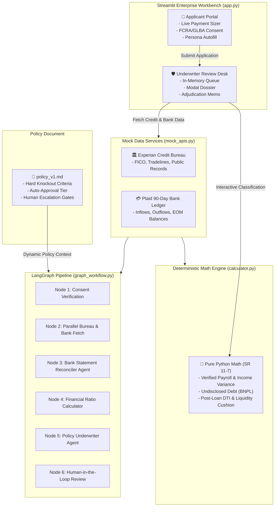

# 🏦 Apex Financial — Institutional Loan Underwriting & Approval Workbench

An enterprise-grade, FCRA & GLBA-compliant personal installment loan underwriting workbench and agentic decisioning platform. Built with **Streamlit**, **LangGraph**, and **Pydantic**, featuring deterministic financial ratio analysis, interactive bank cash flow classification, and human-in-the-loop credit adjudication.

> 💡 **Audience Presentation Quick-Reference**: Explaining banking concepts or ratios to your audience? Jump straight to the [📖 Glossary of Terms & Financial Underwriting Primer](#-glossary-of-terms--financial-underwriting-primer).

---

## 🌟 Executive Summary

Apex Financial delivers a modern, high-trust credit decisioning platform designed for unsecured personal installment loans ($1,000 – $50,000, fixed 36-month term at 12.0% APR).

The system seamlessly combines:
1. **Interactive Dual-Role Web Workbench**:
   - **Loan Applicant Portal**: Real-time installment payment calculator, clean input state with contextual placeholders, regulatory consent capture, and 1-click demo persona autofill.
   - **Credit Underwriting Desk**: Modal-driven adjudication console, interactive bank cash flow categorizer with debit/credit-specific options, instant AI auto-classify shortcut, gated financial ratio worksheet, and a 1-click credit determination action panel with centered error validation.
2. **Deterministic Financial Calculation Engine (`calculator.py`)**:
   - SR 11-7 compliant pure Python functions for post-loan Debt-to-Income (DTI), verified payroll income, undisclosed BNPL debt detection, 90-day NSF event tallying, and liquidity cushion ratios.
3. **Multi-Agent LangGraph Pipeline (`graph_workflow.py`)**:
   - Autonomous multi-agent pipeline using LangGraph and Pydantic structured output for semantic bank reconciliation and dynamic policy evaluation without hardcoded credit policies.
4. **Single Source of Truth Credit Policy (`policy_v1.md`)**:
   - All underwriting tiers, knockout floors, and escalation gates are maintained in Markdown, guaranteeing zero policy hardcoding in business logic.

---

## 🏗️ System Architecture



---

## 📁 Repository Structure

```
loan-agent/
├── pyproject.toml              # Modern PEP 517/621 packaging & pytest configuration
├── requirements.txt            # Production application dependencies
├── requirements-dev.txt        # Development and testing dependencies (pytest, pytest-cov)
├── policy_v1.md                # Apex Financial Credit Underwriting Policy (US-2026)
├── app.py                      # Manual credit underwriting workbench
├── agentic_app.py              # Autonomous LangGraph agentic underwriting workbench
├── .streamlit/
│   └── config.toml             # Streamlit Enterprise light theme configuration
├── loan_agent/                 # Core reusable Python package
│   ├── __init__.py             # Package exports & public API
│   ├── calculator.py           # Pure Python SR 11-7 Financial Ratio Calculator
│   ├── graph_workflow.py       # 6-Node LangGraph Agentic Underwriting Workflow
│   ├── mock_apis.py            # Experian & Plaid REST API Mock Providers & Personas
│   ├── schema.py               # Pydantic Structured Output Schemas (Agents 1 & 2)
│   └── state.py                # LangGraph LoanApplicationState TypedDict
└── tests/                      # Automated unit & integration test suite
    ├── __init__.py
    ├── conftest.py             # Shared pytest fixtures & mock payloads
    ├── test_calculator.py      # Unit tests for financial ratio algorithms
    ├── test_mock_apis.py       # Unit tests for bureau/bank APIs & pre-filtering
    ├── test_schema.py          # Unit tests for Pydantic schemas & state models
    ├── test_workflow.py        # Unit tests for LangGraph nodes, routing, fallback
    └── test_app_helpers.py     # Unit tests for presentation layer & formatters
```

---

## 🚀 Key Modules & Capabilities

### 1. Enterprise Workbench (`app.py`)
- **Light Enterprise Design System**: Styled with a crisp slate and blue palette (Stripe/Mercury style), featuring JetBrains Mono typography for financial metrics.
- **In-Memory Global State (`@st.cache_resource`)**: Data persists across browser refreshes ($F5$ / $\text{Cmd}+R$) while clearing completely on application server restarts—zero persistent disk artifacts or database debris.
- **Credit Tradelines Tab**: Clean audit view with `Tradeline ID` removed, showing creditor name, account type, monthly obligation, 12-month delinquency history, and standing.
- **Bank Cash Flow Tab**: 
  - `Txn Id` removed from the audit display table.
  - Transactions start unclassified by default.
  - Strictly filtered dropdowns: **Credit entries** only display deposit/income options (*Verified Payroll Income*, *One-Off Gift / Transfer*, *Internal Account Transfer*), while **Debit entries** only display expense options (*Known Bureau Debt*, *Undisclosed Debt / BNPL*, *NSF / Overdraft Fee*, *Bank Maintenance Fee*, *Other Living Expense*).
  - **`✨ Auto-Classify (Demo AI)`** shortcut button to instantly categorize all entries using heuristic rules.
- **Financial Ratios Tab**:
  - The **`🧮 Calculate Financial Ratios`** button is disabled until **100% of cash flow transactions** are classified.
  - Generates comprehensive underwriting ratios (*Post-Loan DTI*, *Verified Monthly Income*, *Payment Cushion Ratio*) and an audit table cross-referencing policy guidelines.
  - Dynamically resets when any transaction classification is modified, enabling seamless re-calculation.
- **Adjudication Modal & Action Panel**:
  - Encapsulated inside `st.form` to ensure **1-click approval or rejection** immediately upon typing the justification memorandum, preventing unwanted blur reruns.
  - Centered validation error messages spanning the full decision column.

---

### 2. Autonomous Agentic Workbench (`agentic_app.py`)
- **Direct Pipeline Trigger**: Submitting an application automatically triggers the 6-node LangGraph pipeline.
- **Intelligent Dual-Queue Routing**:
  - **`AUTO_APPROVED` & `AUTO_DENIED`**: Immediately bypass the pending queue and settle into the **Adjudicated / Completed Archive** with permanent audit logging.
  - **`ESCALATE` Only**: Halts at the LangGraph breakpoint before `human_review_node` and appears in the **Pending Loan Review Queue** for credit committee adjudication.
- **Auto-Populated Modal Dossier**:
  - **Bank Cash Flow Tab**: Classifications are auto-populated directly from graph state (`categorized_transactions` produced by the LLM Bank Statement Analyzer).
  - **Financial Ratios Tab**: Ratios are pre-calculated and auto-populated from graph state with on-demand `🔄 Recalculate Ratios` support.
  - **AI Agent Assessment Tab**: Provides full visibility into the AI's recommendation, confidence score, underwriter memo, policy citations, bank analyst narrative, and complete step-by-step execution log.
- **Human Override & LangGraph Resumption**:
  - Credit officers review the AI memo and enter their mandatory justification notes.
  - Clicking **`✅ Approve`** or **`❌ Reject`** updates the graph state (`human_reviewer_decision`, `human_reviewer_notes`) and resumes execution via `graph.invoke(None)`, finalizing as `HUMAN_APPROVED` or `HUMAN_DENIED`.

---

### 3. Financial Ratio Calculator (`calculator.py`)
All financial calculations are isolated in individual, pure functions:

| Function | Purpose | Formula / Logic |
| :--- | :--- | :--- |
| `get_fico_score()` | Extract FICO credit score | Extracted from credit report |
| `has_active_bankruptcy()` | Check active bankruptcy filings | `status == 'ACTIVE'` (Discharged filings ignored) |
| `get_total_delinquencies_12m()` | 12-Month delinquency tally | Sum of 30d + 60d + 90d+ late counts across tradelines |
| `count_nsf_overdraft_events()` | Punitive fee event count | Total 90-day NSF/overdraft ledger events |
| `calculate_verified_monthly_income()` | Bank-verified net payroll | $\frac{\sum \text{Verified Payroll Inflows}}{\text{Statement Months}}$ |
| `calculate_stated_monthly_income()` | Stated monthly gross income | $\frac{\text{Stated Gross Annual Income}}{12}$ |
| `calculate_income_variance_pct()` | Gross vs. net income variance | $\frac{|\text{Stated Monthly} - \text{Verified Monthly}|}{\text{Stated Monthly}} \times 100$ |
| `calculate_monthly_installment()` | Fixed-rate loan installment sizing | $P \times \frac{r(1+r)^n}{(1+r)^n - 1}$ ($r = 0.01$, $n = 36$) |
| `calculate_bureau_monthly_debt()` | Declared tradeline debt load | $\sum \text{Tradeline Monthly Payments}$ |
| `calculate_undisclosed_monthly_debt()` | Hidden debt obligations (BNPL) | $\frac{\sum \text{BNPL / Payday Outflows}}{\text{Statement Months}}$ |
| `calculate_total_post_loan_debt()` | Aggregate post-loan monthly debt | $\text{Bureau Debt} + \text{Hidden Debt} + \text{New Payment}$ |
| `calculate_post_loan_dti()` | Reconciled Post-Loan DTI % | $\frac{\text{Total Post-Loan Debt}}{\text{Verified Monthly Income}} \times 100$ |
| `calculate_avg_ending_balance()` | 90-Day average checking reserve | $\frac{\sum \text{EOM Ending Balances}}{\text{Months}}$ |
| `calculate_payment_cushion_ratio()` | Reserve liquidity multiple | $\frac{\text{Average Ending Balance}}{\text{New Monthly Loan Payment}}$ |
| `compute_financial_ratios()` | Master underwriting ratio engine | Bundles all metrics into a standardized dictionary |

---

### 4. Agentic LangGraph Underwriting Pipeline (`graph_workflow.py`)
A 6-node state machine orchestrating AI-driven credit analysis:
- **Node 1 (`verify_fcra_consent_node`)**: Regulatory gate ensuring explicit borrower consent before accessing bureau or banking data.
- **Node 2 (`fetch_external_data_parallel_node`)**: Parallel retrieval of Experian credit records and Plaid bank ledgers.
- **Node 3 (`bank_statement_analyzer_agent`)**: LLM-powered agent identifying verified income, undisclosed BNPL debt, and fee reversals.
- **Node 4 (`calculate_financial_ratios_node`)**: Pure Python mathematical calculation node.
- **Node 5 (`underwriter_agent_node`)**: Policy evaluation agent dynamically assessing `policy_v1.md` rules and generating ECOA-compliant adverse action notices when denying.
- **Node 6 (`human_review_node`)**: Human-in-the-loop review station for manual credit committee approval or sign-off.

---

## 👥 Demo Borrower Personas

The system includes 3 pre-configured demo borrower profiles accessible via the **`⚡ Autofill Demo Persona`** shortcut in the Applicant Portal:

```
┌─────────────────────────────────────────────────────────────────────────────┐
│ 1. Sarah Jenkins — Clean Auto-Approve (Prime)                                │
│    • Requested: $15,000 | Stated Income: $96,000/yr ($8,000/mo)             │
│    • FICO: 745 | Delinquencies: 0 | NSF Fees: 0                             │
│    • Public Records: Discharged Bankruptcy from 2019 (Compliant)            │
│    • Result: Passes all criteria, healthy DTI (< 36%), 4.2x cushion.        │
├─────────────────────────────────────────────────────────────────────────────┤
│ 2. Marcus Vance — Hard Knockout Denial (Subprime)                            │
│    • Requested: $20,000 | Stated Income: $60,000/yr ($5,000/mo)             │
│    • FICO: 580 (Violates Rule 2.1 < 620)                                    │
│    • Active Bankruptcy (Violates Rule 2.3) | 2x Delinquencies (Rule 2.3)    │
│    • 3x NSF Events in 90 Days (Violates Rule 2.4 > 2)                       │
│    • Result: Immediate ECOA Adverse Action Denial with specific citations.   │
├─────────────────────────────────────────────────────────────────────────────┤
│ 3. David Chen — Manual Underwriting Escalation (Nuanced / High-Value)        │
│    • Requested: $35,000 (Exceeds $25,000 Tier 1 Gate per Rule 4.2)          │
│    • Stated Income: $110,000/yr | FICO: 710                                 │
│    • Undisclosed BNPL detected (Klarna / Affirm payments)                   │
│    • Result: Routes to ESCALATE for human underwriter executive sign-off.   │
└─────────────────────────────────────────────────────────────────────────────┘
```

---

## ⚙️ Installation & Setup

### Prerequisites
- Python 3.10, 3.11, 3.12, or 3.13
- Virtual environment (`venv` or `conda`)

### 1. Clone & Set Up Virtual Environment
```bash
cd /Users/vipar/Data/projects/loan-agent
python3 -m venv venv
source venv/bin/activate
```

### 2. Install Dependencies
```bash
# Core application dependencies
pip install -r requirements.txt

# Development and test dependencies (pytest, pytest-cov)
pip install -r requirements-dev.txt
```

### 3. Configure Environment Variables
Create or edit `.env` in the root directory to configure the LLM provider for the agentic workflow:
```bash
# LLM Provider Configuration (Defaults to Groq's OpenAI-compatible endpoint)
LLM_BASE_URL=https://api.groq.com/openai/v1
LLM_MODEL=openai/gpt-oss-120b

# Your API Key (Groq, OpenAI, or compatible gateway)
GROQ_API_KEY=gsk_your_groq_api_key_here
# Alternatively: OPENAI_API_KEY=sk-... or LLM_API_KEY=...
```

---

## 🖥️ Running the Applications

Apex Financial provides two side-by-side implementations to demonstrate the evolution from manual credit underwriting to autonomous agentic decisioning:

### Option 1: Autonomous Agentic Workbench (`agentic_app.py`)

In this mode, the loan submission triggers the 6-node LangGraph pipeline. Automated decisions (`AUTO_APPROVED` / `AUTO_DENIED`) settle immediately into the archive, while complex files (`ESCALATE`) halt at the Human-in-the-Loop breakpoint and populate the Underwriter Review Queue with pre-populated AI assessments.

```bash
streamlit run agentic_app.py
```
Open your browser at `http://localhost:8501`.

#### Recommended Agentic Walkthrough:
1. Navigate to the **Applicant Portal**.
2. Click **`⚡ Autofill Demo Persona`**:
   - **Sarah Jenkins (Prime)**: Click Submit → AI Underwriter approves automatically per Tier 1 rules → application immediately moves to the **Adjudicated / Completed Archive** with status `AUTO_APPROVED`.
   - **Marcus Vance (Subprime)**: Click Submit → AI Underwriter detects knockout criteria (FICO < 620, DTI > 45%, 4 NSF fees) → application immediately moves to the **Adjudicated / Completed Archive** with status `AUTO_DENIED` and ECOA adverse action notices.
   - **David Chen (Nuanced / High-Value)**: Click Submit → loan amount ($35,000) and income variance (>15%) trigger Section 4 escalation → graph pauses execution before `human_review_node` → appears in the **Pending Loan Review Queue**.
3. Switch to the **Underwriter Desk** via the sidebar navigation.
4. Click **Review & Adjudicate ↗** on David Chen's escalated file:
   - **`🤖 AI Assessment` Tab**: Review the AI recommendation (`ESCALATE`), confidence score, detailed underwriter memorandum, policy citations, bank analyst narrative, and complete LangGraph execution trace.
   - **`💳 Bank Cash Flow` Tab**: Observe how all transactions are **auto-populated and pre-classified** by the AI Bank Statement Analyst agent.
   - **`📊 Financial Ratios` Tab**: Observe how all financial metrics (*Post-Loan DTI*, *Payment Cushion Ratio*, *Income Variance*) are **auto-populated from the graph state** without needing manual computation.
5. In the **Human Credit Officer Determination** action panel on the right:
   - Review the AI Agent Escalation briefing callout.
   - Enter your justification notes into **Credit Officer Justification** (e.g., *"Verified W-2 documentation confirms valid bonus structure; approved 41.8% DTI within near-prime tier"*).
   - Click **`✅ Approve`** (or **`❌ Reject`**).
   - The system updates graph state and resumes execution, finalizing the loan as `HUMAN_APPROVED`.
6. Navigate to the **Adjudicated / Completed Archive** to inspect the full audit trail and officer notes.

---

### Option 2: Manual Underwriting Workbench (`app.py`)

In this baseline mode, the credit officer performs the entire manual workflow from scratch (manual bank ledger classification, manual ratio calculation, and manual adjudication).

```bash
streamlit run app.py
```

#### Recommended Manual Walkthrough:
1. Navigate to the **Applicant Portal**.
2. Click **`⚡ Autofill Demo Persona`** and select **Sarah Jenkins** (or Marcus Vance / David Chen).
3. Observe how the **Calculated Installment** updates instantly with any change to the requested loan amount.
4. Check the FCRA authorization box and click **Submit Loan Application**.
5. Switch to the **Underwriter Desk** via the sidebar navigation.
6. Click **Review & Adjudicate ↗** on the submitted application to open the modal dossier.
7. Under the **Bank Cash Flow** tab, either classify entries manually or click **`✨ Auto-Classify (Demo AI)`**.
8. Navigate to the **Financial Ratios** tab and click **`🧮 Calculate Financial Ratios`** to generate the ratio scorecard.
9. Type your credit rationale into **Credit Officer Justification** and click **✅ Approve** or **❌ Reject**.
10. Inspect the completed record in the **Adjudicated / Completed Archive** audit trail.

---

## 🧪 Testing & Validation

The project includes both fast deterministic unit tests and live multi-agent LangGraph integration tests:

```bash
# 1. Run fast unit test suite (72 unit tests, zero API cost)
pytest -m "not integration"

# 2. Run unit tests with code coverage report
pytest --cov

# 3. Run live LangGraph integration tests across the 3 borrower personas:
#    - Sarah Jenkins (AUTO_APPROVED)
#    - Marcus Vance (AUTO_DENIED with ECOA adverse action notices)
#    - David Chen (ESCALATE, StateGraph breakpoint pause & human review resumption)
pytest tests/test_integration_workflow.py
```

---

## 📖 Glossary of Terms & Financial Underwriting Primer

> **Audience Presentation Cheat Sheet**: Use this section to explain banking regulations, ecosystem entities, credit concepts, mathematical formulas, and AI governance mechanisms implemented across this project.

---

### 1. 🏛️ Key Industry Players & Ecosystem Entities

| Entity / Role | Category | Function in This System | Industry Real-World Context |
| :--- | :--- | :--- | :--- |
| **Experian** | Consumer Reporting Agency (CRA) / Credit Bureau | Source of historical consumer credit records: FICO credit scores, active tradelines (revolving, installment, mortgage), payment history, and adverse public records (bankruptcies, judgments, liens). | One of the "Big Three" nationwide US credit bureaus (alongside Equifax and TransUnion). Lenders report consumer debt balances and payment statuses monthly under the FCRA. |
| **Plaid** | Open Banking Financial Data Aggregator | Securely connects to the borrower's checking account via tokenized APIs to fetch 90 days of categorized banking transactions, end-of-month balances, and cash flows without credential storage. | Leading financial technology gateway used by thousands of banks and fintechs (e.g., Venmo, Robinhood, Chime, SoFi) to verify borrower accounts and income in real-time. |
| **Apex Financial** | Direct Institutional Creditor / Lender | The underwriting institution that originates, prices, and funds the personal installment loan ($1,000 to $50,000, 36-month fixed term at 12.0% APR). | An institutional consumer lender operating under state lending licenses and federal banking oversight (CFPB, FTC, Federal Reserve). |
| **Credit Officer / Underwriter** | Human Adjudicator (HitL) | Licensed credit professional with lending authority who reviews escalated loan files, examines income variances or high-loan sizing, and issues final approvals or adverse actions. | Second-line credit risk adjudicator responsible for portfolio quality, compliance sign-offs, and manual policy exceptions that fall outside automated approval bounds. |
| **Autonomous AI Underwriter** | LangGraph Agentic Pipeline | Dual LLM reasoning pipeline (Bank Statement Analyzer + Policy Underwriter) that reconciles bank cash flows against bureau debt and dynamically evaluates underwriting guidelines. | Advanced agentic system executing structured policy reasoning while keeping deterministic calculations separate per SR 11-7 standards. |

---

### 2. ⚖️ Regulatory Frameworks & Compliance Mandates

#### A. FCRA (Fair Credit Reporting Act — 15 U.S.C. § 1681)
* **What it is**: The landmark US federal law enacted in 1970 that regulates the collection, dissemination, and privacy of consumer credit information.
* **Why it matters here**: Lenders cannot legally inspect consumer credit reports or access bank account ledgers without a certified **Permissible Purpose** and **Explicit Consumer Consent**.
* **Implementation in Code**:
  - In the **Applicant Portal**, the borrower must affirmatively check the FCRA/GLBA authorization checkbox before submitting.
  - In [`loan_agent/graph_workflow.py`](file:///Users/vipar/Data/projects/loan-agent/loan_agent/graph_workflow.py), **Node 1 (`validate_consent_node`)** acts as a technical gatekeeper: if `fcra_consent is False`, execution is immediately halted before any external API (Experian/Plaid) is reached, returning `REJECT_NO_CONSENT`.

#### B. GLBA (Gramm-Leach-Bliley Act — 15 U.S.C. § 6801)
* **What it is**: The Financial Services Modernization Act of 1999, specifically its **Financial Privacy Rule** and **Safeguards Rule**, requiring financial institutions to protect consumers' Non-Public Personal Information (NPI).
* **Why it matters here**: Restricts the unauthorized sharing, persistent storage, and exposure of sensitive identifying data (e.g., Social Security Numbers, bank account masks, transaction logs).
* **Implementation in Code**:
  - Only the **last 4 digits of the SSN** (`ssn_last_4`) are ever collected or transmitted.
  - The system utilizes **in-memory session state** (`@st.cache_resource`) that completely wipes on server restart—zero unencrypted consumer files or database debris are left on disk.

#### C. ECOA (Equal Credit Opportunity Act — Regulation B, 12 C.F.R. Part 1002)
* **What it is**: Federal civil rights law prohibiting creditors from discriminating against credit applicants based on race, color, religion, national origin, sex, marital status, or age.
* **Mandatory Adverse Action Requirement**: When a lender denies credit, ECOA legally mandates providing the applicant with a written **Adverse Action Notice** citing the specific, objective reasons for rejection (e.g., *FICO score below minimum threshold*, *Excessive delinquencies*, *Debt-to-Income ratio exceeds policy limit*).
* **Implementation in Code**:
  - The policy underwriter schema (`UnderwritingOutput` in [`schema.py`](file:///Users/vipar/Data/projects/loan-agent/loan_agent/schema.py)) enforces that whenever `underwriting_decision == "DENY"`, the agent **must populate `adverse_action_reasons`** with exact, legally compliant statements.
  - Marcus Vance's automated denial displays these citations prominently in the audit archive.

#### D. SR 11-7 (Supervisory Guidance on Model Risk Management)
* **What it is**: Joint regulatory guidance issued by the Federal Reserve and OCC governing the design, implementation, and validation of automated models in banking.
* **Core Principle**: Financial math must be **transparent, deterministic, auditable, and mathematically reproducible**. Opaque generative AI models should not perform arithmetic (which is prone to hallucinations and rounding errors).
* **Implementation in Code**:
  - **100% Separation of Math and Language**: All ratio formulas live in [`calculator.py`](file:///Users/vipar/Data/projects/loan-agent/loan_agent/calculator.py) as pure Python functions.
  - The LLM agents only classify text descriptions (e.g. tagging transaction categories); the deterministic Python math engine computes all DTIs, cushions, and variance percentages.

---

### 3. 📊 Credit Bureau Concepts & Risk Terminology

#### A. FICO® Score
* **Definition**: The industry-standard 3-digit credit score developed by Fair Isaac Corporation ranging from **300 to 850**, evaluating the probability of loan default within the next 24 months.
* **Scoring Composition**:
  - **35% Payment History**: Track record of on-time payments vs. 30/60/90+ day late payments.
  - **30% Amounts Owed / Credit Utilization**: Total balance divided by available credit limit (healthy is $<30\%$).
  - **15% Length of Credit History**: Age of oldest account and average age of all accounts.
  - **10% Credit Mix**: Variety of credit types (revolving cards vs. installment loans vs. mortgages).
  - **10% New Credit**: Recent hard credit inquiries and newly opened lines.
* **Underwriting Policy Tiers**:
  - **Prime (Tier 1)**: $\ge 680$ (Eligible for automated approval if other gates pass).
  - **Near-Prime (Tier 2)**: $620 - 679$ (Eligible for approval or human review).
  - **Subprime Knockout**: $< 620$ (Hard rejection knockout per Rule 2.1).

#### B. Credit Tradelines
* **Definition**: An individual account listed on a credit bureau report representing an agreement with a specific creditor (e.g., auto loan with Chase Auto, credit card with Capital One, student loan with Navient).
* **Key Tradeline Attributes**:
  - **Creditor Name & Account Type**: Revolving credit, installment loan, auto loan, or mortgage.
  - **Monthly Obligation**: The required minimum contractual payment due each billing cycle.
  - **Standing**: Current (in good standing) vs. Delinquent.
  - **12-Month Delinquency History**: Count of late payment events bucketed into 30-day, 60-day, and 90-plus day increments. More than 1 late payment in 12 months disqualifies a prime automated approval.

#### C. Adverse Public Records (Active vs. Discharged Bankruptcies)
* **Active Bankruptcy**: The borrower is currently undergoing legal bankruptcy proceedings (Chapter 7 liquidation or Chapter 13 repayment). Federal banking law and Apex Policy consider an active bankruptcy a **hard knockout** because the debtor is under court supervision and cannot legally incur new unapproved debt.
* **Discharged Bankruptcy**: The court has concluded the bankruptcy and permanently released the debtor from liability. Per Apex Policy (Rule 2.3), historical bankruptcies that have been **discharged for $\ge 5$ years** with subsequent clean credit re-establishment (e.g., Sarah Jenkins' 2018 discharge) are **permitted** and do not trigger a knockout.

---

### 4. 💳 Bank Cash Flow & Ledger Analytics

#### A. Verified Net Payroll vs. Stated Gross Income
* **Stated Gross Annual Income**: The self-reported pre-tax earnings entered by the borrower on their loan application.
* **Verified Net Monthly Income**: The actual recurring payroll direct deposits from an employer detected inside the 90-day bank ledger, divided by statement months.
* **Why Both Matter**: Borrowers frequently overstate income or confuse gross salary with net take-home pay. Comparing both yields the **Income Variance %**.

#### B. Non-Sufficient Funds (NSF) & Overdraft Fees
* **Definition**: Punitive penalty charges (typically $35 per event) assessed by a bank when an account balance dips below zero or a check/ACH bounces.
* **Underwriting Significance**: While credit bureau scores measure historical debt over years, NSF events measure **immediate, real-time liquidity distress**. More than 2 NSF events within the last 90 days indicates an immediate risk of default and triggers a hard knockout (Rule 2.4).

#### C. Undisclosed Debt / BNPL (Buy Now, Pay Later)
* **Definition**: Short-term consumer financing agreements (e.g., Affirm, Klarna, Afterpay, or online payday installments) with bi-weekly or monthly payments.
* **The "Phantom Debt" Problem**: Most BNPL providers do not report active installment plans to credit bureaus. As a result, Experian credit reports often show a clean tradeline profile even when the borrower has hundreds of dollars committed to BNPL loans each month.
* **Our Solution**: The **Bank Statement Analyzer Agent** scans all bank ledger debits, identifies recurring BNPL debits, and computes the `undisclosed_monthly_debt` so it is factored into the total post-loan DTI.

---

### 5. 🧮 Underwriting Financial Ratios & Exact Formulas

The deterministic math engine in [`loan_agent/calculator.py`](file:///Users/vipar/Data/projects/loan-agent/loan_agent/calculator.py) computes the following core metrics:

#### 1. Monthly Loan Payment Sizing (Standard Fixed-Rate Amortization)
Calculates the exact monthly installment for a fully amortizing fixed-rate personal loan:
$$\text{Monthly Payment } (M) = P \times \frac{r(1+r)^n}{(1+r)^n - 1}$$
* $P$ = Principal loan amount requested ($1,000 to $50,000)
* $r$ = Periodic monthly interest rate ($\frac{\text{Annual Rate}}{12} = \frac{0.12}{12} = 0.01$ for 12.0% APR)
* $n$ = Total term in months ($36$ months)
* *Example*: For a $\$15,000$ loan at $12.0\%$ APR over $36$ months, $M = \$498.21/\text{month}$.

#### 2. Verified Monthly Payroll Income
Measures verified monthly net cash inflow based strictly on payroll direct deposits:
$$\text{Verified Monthly Income} = \frac{\sum \text{Verified Payroll Inflows}}{\text{Statement Period in Months (3.0)}}$$
* Excludes one-off peer-to-peer gifts (e.g. Zelle from family), tax refunds, and internal transfers between accounts.

#### 3. Stated Monthly Gross Income
Converts self-reported annual income to an equivalent monthly benchmark:
$$\text{Stated Monthly Income} = \frac{\text{Stated Annual Gross Income}}{12}$$

#### 4. Income Variance Percentage
Evaluates discrepancy between stated gross earnings and verified net payroll:
$$\text{Income Variance \%} = \frac{|\text{Stated Monthly Income} - \text{Verified Monthly Income}|}{\text{Stated Monthly Income}} \times 100$$
* **Policy Rules**:
  - $\le 10\%$: Tier 1 Prime compliance.
  - $\le 25\%$: Acceptable near-prime variance (often explained by standard tax withholdings, 401(k), and healthcare deductions).
  - $> 15\%$: Triggers automatic **Escalation Gate** (Rule 4.1) for human underwriter documentation verification (e.g., David Chen's 21.45% variance).

#### 5. Total Post-Loan Monthly Debt Obligation
Aggregates all existing and prospective monthly debt commitments:
$$\text{Total Post-Loan Debt} = \text{Bureau Monthly Debt} + \text{Undisclosed Monthly Debt (BNPL)} + \text{New Loan Installment}$$
* **Bureau Monthly Debt**: Sum of all declared monthly obligations from Experian tradelines.
* **Undisclosed Monthly Debt**: Sum of recurring non-bureau installment payments (BNPL, payday loans) detected in the bank ledger, normalized to a monthly average.
* **New Loan Installment**: Sized monthly payment calculated in Formula #1.

#### 6. Reconciled Post-Loan Debt-to-Income (DTI) Ratio
The primary indicator of borrower debt capacity and leverage:
$$\text{Post-Loan DTI \%} = \left( \frac{\text{Total Post-Loan Monthly Debt}}{\text{Verified Monthly Income}} \right) \times 100$$
* **Policy Benchmarks**:
  - $\le 36.00\%$: Prime Tier 1 Auto-Approval (Sarah Jenkins: ~24.98%).
  - $36.01\% - 45.00\%$: Near-Prime / Human Escalation Tier (David Chen: ~41.84%).
  - $> 45.00\%$: Hard Knockout Denial per Rule 2.2 (Marcus Vance: ~63.96%).

#### 7. Liquidity Payment Cushion Ratio (Reserve Multiple)
Measures liquidity buffer and checking account reserve strength against the new loan payment:
$$\text{Payment Cushion Ratio} = \frac{\text{Average 90-Day Ending Checking Balance}}{\text{New Monthly Loan Payment}}$$
* **Average Ending Balance**: Average of the 3 end-of-month (EOM) statement closing balances.
* **Policy Benchmark**: Must be $\ge 2.0\times$ for Tier 1 automated approval, verifying that the borrower maintains liquid cash reserves of at least two full monthly loan payments.

---

### 6. 🚦 Workflow Decision States & Terminology

| Decision / Status | Adjudicator | Meaning & Next Action |
| :--- | :--- | :--- |
| **`AUTO_APPROVED`** | Autonomous Agent | The loan application satisfied all Tier 1 Prime benchmarks (FICO $\ge 680$, DTI $\le 36\%$, cushion $\ge 2.0\times$, clean tradelines, 0 active bankruptcies). Moved immediately to the Adjudicated Archive. |
| **`AUTO_DENIED`** | Autonomous Agent | The borrower breached one or more Section 2 Hard Knockout rules (FICO $< 620$, DTI $> 45\%$, $>1$ delinquency, $>2$ NSFs). Moved immediately to the Adjudicated Archive with ECOA adverse action notices. |
| **`REJECT_NO_CONSENT`** | Consent Gatekeeper | The applicant did not supply explicit FCRA/GLBA authorization. System halted external API calls before fetching bureau or bank data. |
| **`ESCALATE`** | Autonomous Agent | The file passed all hard knockouts, but breached one or more Section 4 Escalation gates (loan amount $> \$25,000$, income variance $> 15\%$, or DTI between $36.01\%$ and $45\%$). Pauses before human review and enters the **Pending Review Queue**. |
| **`HUMAN_APPROVED`** | Credit Officer | A human underwriter reviewed the escalated file, validated supporting documents (W-2s, tax withholdings), recorded an audit justification, and overrode/granted credit approval. |
| **`HUMAN_DENIED`** | Credit Officer | A human underwriter reviewed the escalated file and issued an adverse action rejection with a recorded credit rationale. |

